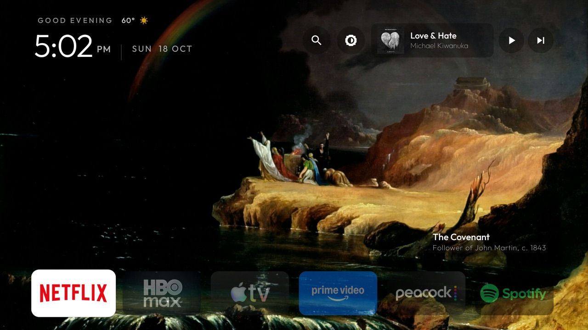
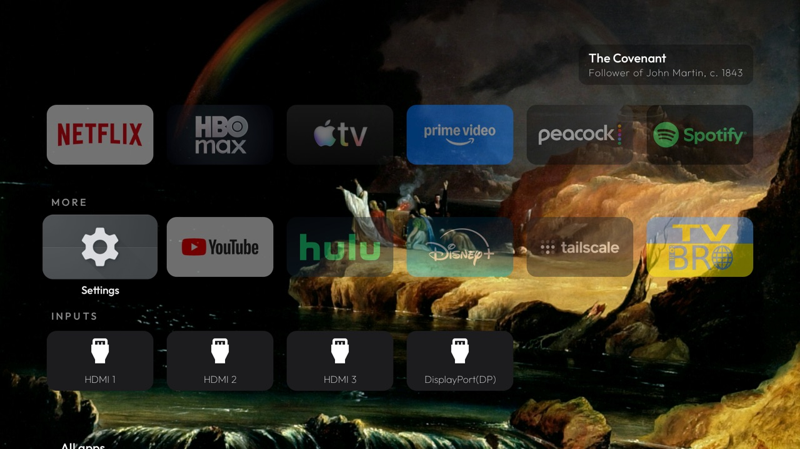
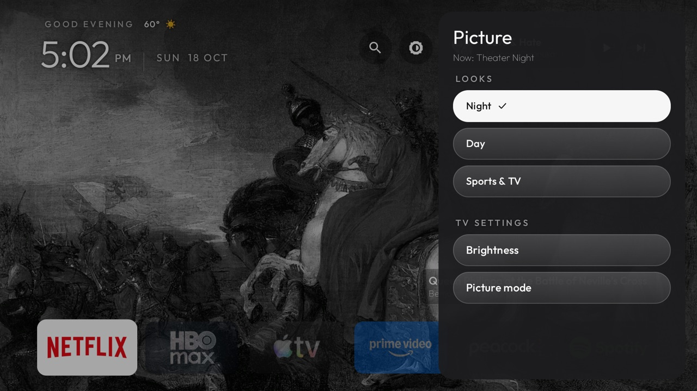

# tv-vibehack

**A calm, ad-free home screen for Android TV and Google TV, set up for your TV and your taste.**

Your TV's stock home screen is mostly ads and "Top picks". This replaces it with a minimal launcher:
your six favourite apps over a rotating painting from the Art Institute of Chicago, a clock and the
weather, what's playing, search across your apps, one-press picture settings tuned for your exact
TV, and your team's game when it's game day. Everything else waits one scroll below.

| Stock Google TV | After |
|---|---|
|  |  |

You don't need to be a developer. The easiest way is to let an AI coding assistant (Claude Code or
similar) do the work with you: it connects to your TV over your Wi-Fi, asks what you watch, researches
the best picture settings for your model, and sets everything up, checking each step on the real TV.
Everything is reversible.

## What you get

- **Minimal first screen.** Clock, weather, and up to six favourite apps along the bottom, faint until
  you land on one. Scroll down for the rest: a "More" row, your HDMI inputs and every other app.
- **Art.** A different public-domain painting every minute (Art Institute of Chicago), with a small
  museum-style label.
- **Now playing.** Song, artist and play/pause/next for whatever's playing. With nothing playing it
  offers your music app; Play resumes your last song without opening it.
- **Search.** Your apps, plus movies and shows with "Watch on …" buttons for the apps you have.
- **Picture looks** (supported TVs, see [docs/PICTURE.md](docs/PICTURE.md)). *Night*, *Day* and *Sports & TV*
  presets researched for your model, for regular, HDR and Dolby Vision content, plus shortcuts into
  the TV's Brightness and Picture Mode menus. A spare remote button opens them over anything you're watching.
- **Game day.** On game days your team's game appears above the apps; one press tunes the right
  antenna channel or opens the streaming app that has it. Spoiler-free by default.
- **Your layout.** Hold OK on any app to move it, or send it to Favourites, More or All apps.
- **No ads, no recommendations, no tracking.** The TV's own ad and promo apps are switched off.

| Below the fold | Picture panel |
|---|---|
|  |  |

## Set it up

**Recommended: with an AI assistant.** Follow [docs/SETUP.md](docs/SETUP.md) to put your TV in developer
mode (two minutes), then paste [PROMPT.md](PROMPT.md) into Claude Code and answer its questions. It
takes about an hour, most of it the assistant working.

**By hand:** [docs/SETUP.md](docs/SETUP.md) has every step: connecting, choosing apps, the search key,
building, installing.

## How it fits together

| Path | What it is |
|---|---|
| [`PROMPT.md`](PROMPT.md) | The prompt for your AI assistant: a guided setup interview. |
| [`docs/SETUP.md`](docs/SETUP.md) | Step-by-step setup, for people and assistants. |
| [`docs/CONFIG.md`](docs/CONFIG.md) | Every setting in `config.xml`, with common app package names. |
| [`docs/PICTURE.md`](docs/PICTURE.md) | How picture looks work and how to make them for your TV. |
| [`docs/TROUBLESHOOTING.md`](docs/TROUBLESHOOTING.md) | Everything that went wrong once, and the fix. |
| [`examples/`](examples/) | TV profiles: a folder per TV with its settings, picture recipes and debloat list. Start from [`examples/_template`](examples/_template). |
| [`launcher/`](launcher/) | The launcher app (Java, small, no ads or tracking). |
| [`tools/`](tools/) | Connect, debloat and restore scripts. |

Your own settings live in a **TV profile**, `examples/<your-tv>/`, so the app itself stays generic:

```bash
TV_SERIAL=192.168.1.50:41234 TV_PROFILE=examples/my-tv launcher/build-and-install.sh
```

## Supported TVs

Any Android TV or Google TV (Hisense, TCL, Sony, Philips, Xiaomi, Nvidia Shield, Chromecast with
Google TV…). Not Samsung, LG or Fire TV (different systems). The picture looks need a per-TV profile;
the [Hisense 55U8QG](examples/hisense-55u8qg) one is complete and other Hisense Google TVs are likely
close. Everything else works on any Android TV.

## Undo

Nothing is uninstalled. `tools/restore.sh examples/<your-tv>/debloat.txt` turns everything back on and
makes the stock home screen the default again.

## Licence

MIT, see [`LICENSE`](LICENSE). Paintings: Art Institute of Chicago public-domain collection (CC0).
Weather: Open-Meteo. Search data: TMDB and JustWatch. Schedules: ESPN. The Outfit typeface is under
the SIL Open Font License (`launcher/FONT-LICENSE-OFL.txt`).

Started by [gathin23](https://github.com/gathin23/tv-vibehack); extended for a Hisense Google TV.
